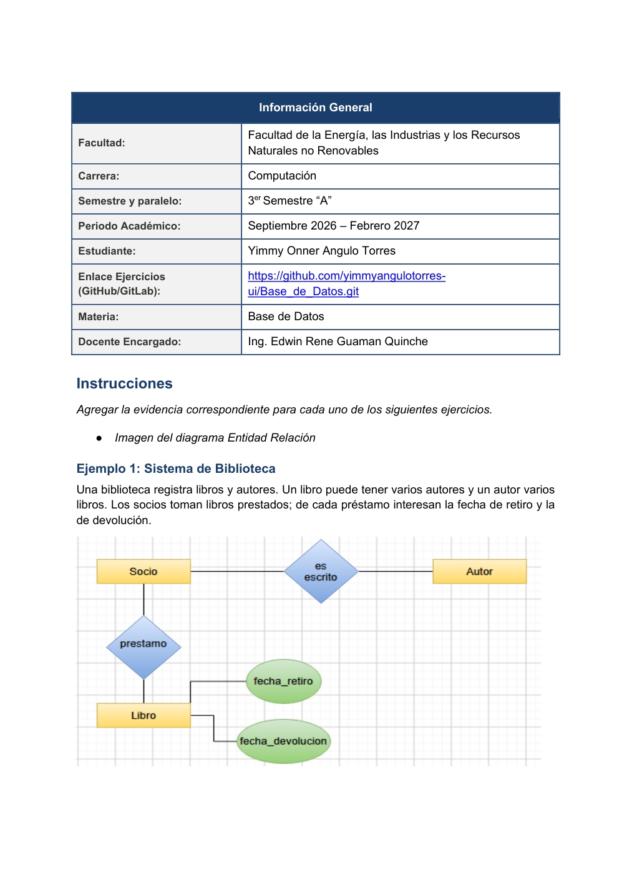

# 📘 Ejemplo 1: Sistema de Biblioteca

 

---

## 📖 Contexto del ejercicio

Una biblioteca necesita registrar socios, libros, autores y los préstamos realizados, incluyendo fechas de retiro y devolución.

## 🔎 Identificación del modelo entidad-relación

**Entidades:** Socio, Libro y Autor. **Relaciones:** préstamo y autoría. **Consideración:** las fechas pertenecen al préstamo.

## 🖼️ Página completa del material original

> **Nota:** se muestra la página original completa, sin recortes. Incluye el enunciado y cualquier gráfico presente en el PDF; no constituye una solución ER verificada.

## 💭 Explicación

A partir del contexto, se identifican las entidades y sus atributos; después se establecen las relaciones y se determinan las cardinalidades que correspondan a las reglas del caso. Finalmente se representa el modelo mediante un diagrama ER.

---

