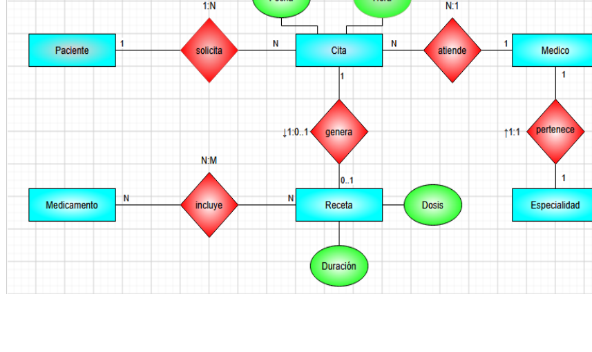

# 📘 Ejemplo 3: Clínica Médica

 

---

## 📖 Contexto del ejercicio

Los pacientes solicitan citas; cada cita la atiende un médico a un paciente en fecha, hora y consultorio. De algunas citas se genera una receta que incluye medicamentos con dosis y duración. Cada médico pertenece a una especialidad.

## 🔎 Identificación del modelo entidad-relación

**Entidades:** Paciente, Médico, Especialidad, Cita, Receta y Medicamento. **Relaciones:** atención médica y prescripción.

## 🖼️ Diagrama entidad-relación completo

> **Imagen completa:** captura proporcionada, ampliada proporcionalmente a 3840 píxeles de ancho, sin recortes. La ampliación no recupera detalle que no exista en la captura original.

## 💭 Explicación

A partir del contexto, se identifican las entidades y sus atributos; después se establecen las relaciones y se determinan las cardinalidades que correspondan a las reglas del caso. Finalmente se representa el modelo mediante un diagrama ER.

---

