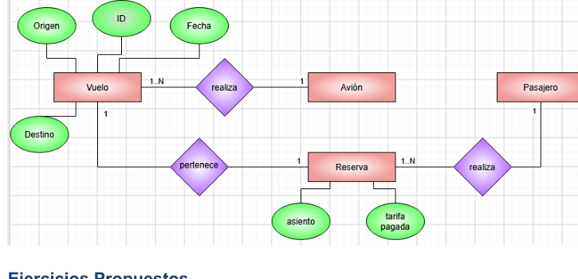

# 📘 Ejemplo 4: Sistema de Aerolínea

 

---

## 📖 Contexto del ejercicio

Una aerolínea gestiona vuelos, aviones, pasajeros y reservas, con información del asiento y la tarifa.

## 🔎 Identificación del modelo entidad-relación

**Entidades:** Vuelo, Avión, Pasajero y Reserva. **Relaciones:** asignación de avión y reserva de pasajero.

## 🖼️ Material gráfico del PDF

> **Importante:** imagen extraída del material facilitado. Es una referencia visual y no debe asumirse como diagrama ER verificado. Revisa el enunciado para validar entidades, atributos y cardinalidades.

## 💭 Explicación

A partir del contexto, se identifican las entidades y sus atributos; después se establecen las relaciones y se determinan las cardinalidades que correspondan a las reglas del caso. Finalmente se representa el modelo mediante un diagrama ER.

---

