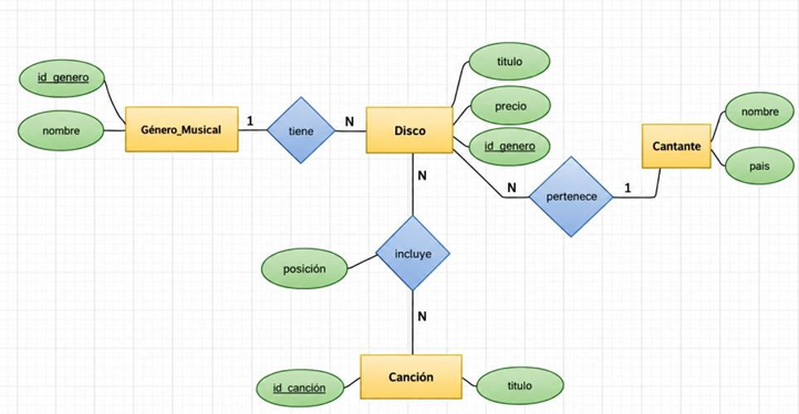

# 📝 Ejercicio 7: Discos Musicales

 

---

## 📖 Contexto del ejercicio

Una colección musical almacena discos, géneros, cantantes y canciones, incluyendo la posición de cada canción.

## 🔎 Identificación del modelo entidad-relación

**Entidades:** Disco, Género, Cantante y Canción. **Relaciones:** clasificación, interpretación y composición de discos.

## 🖼️ Diagrama entidad-relación completo

> **Imagen completa:** captura proporcionada, ampliada proporcionalmente a 3840 píxeles de ancho, sin recortes. La ampliación no recupera detalle que no exista en la captura original.

## 💭 Explicación

A partir del contexto, se identifican las entidades y sus atributos; después se establecen las relaciones y se determinan las cardinalidades que correspondan a las reglas del caso. Finalmente se representa el modelo mediante un diagrama ER.

---

