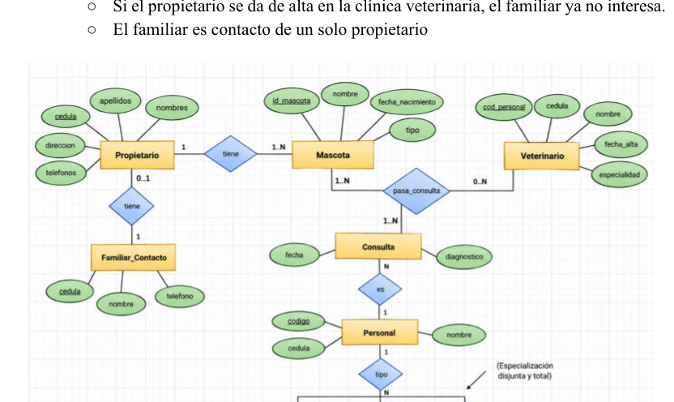

# 📝 Ejercicio 9: Veterinaria

 

---

## 📖 Contexto del ejercicio

Una veterinaria gestiona propietarios, mascotas, personal, consultas, diagnósticos y contactos de emergencia.

## 🔎 Identificación del modelo entidad-relación

**Entidades:** Propietario, Mascota, Personal, Veterinario, Auxiliar y Familiar. **Relaciones:** propiedad, consulta y contacto.

## 🖼️ Material gráfico del PDF

> **Importante:** imagen extraída del material facilitado. Es una referencia visual y no debe asumirse como diagrama ER verificado. Revisa el enunciado para validar entidades, atributos y cardinalidades.

## 💭 Explicación

A partir del contexto, se identifican las entidades y sus atributos; después se establecen las relaciones y se determinan las cardinalidades que correspondan a las reglas del caso. Finalmente se representa el modelo mediante un diagrama ER.

---

