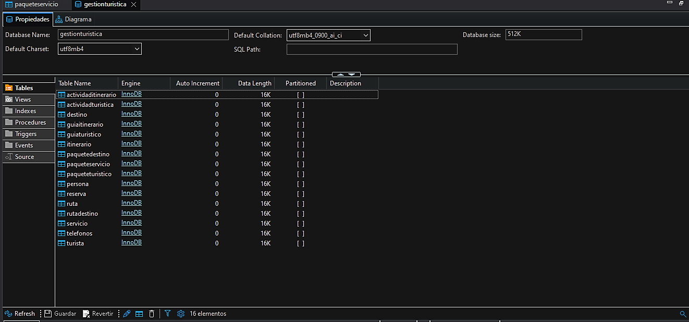

# 💻 5. Código SQL

[](README.md) [](06-consultas.md)

---

## 🏗️ 5.1. Creación de tablas (DDL)

La creación de tablas mediante el lenguaje SQL (DDL) permitió establecer la estructura de la base de datos para el sistema de gestión de la agencia de turismo de la ciudad de Loja. Para ello, se tomaron como referencia las entidades identificadas en el modelo E-R, entre ellas **Cliente**, **GuiaTuristico**, **Destino**, **PaqueteTuristico**, **Reserva**, **Servicio** e **Itinerario**, definiendo sus respectivos atributos y tipos de datos de acuerdo con la información que se necesita almacenar en cada una.

Mediante la sentencia **CREATE TABLE** se construyeron las tablas, estableciendo restricciones como **PRIMARY KEY**, **NOT NULL**, **UNIQUE**, **DEFAULT** y **CHECK**, además de las claves foráneas mediante **FOREIGN KEY ... REFERENCES** para mantener la integridad referencial entre ellas. De esta manera, se consiguió una estructura organizada que permite almacenar correctamente los registros, evitar datos duplicados y mantener las relaciones necesarias para el funcionamiento de la base de datos.

### 🗄️ Creación de la base de datos

```sql
CREATE DATABASE gestionturistica;
```

### 🧱 Estructura de la Tabla Persona

```sql
CREATE TABLE Persona(
  cedula VARCHAR(10) PRIMARY KEY,
  primer_nombre VARCHAR(40) NOT NULL,
  apellido_paterno VARCHAR(40) NOT NULL,
  correo VARCHAR(40) NOT NULL UNIQUE,
  direccion TEXT NOT NULL
);
```

### 🧱 Estructura de la Tabla Turista

```sql
CREATE TABLE Turista(
  Id_Turista int PRIMARY KEY,
  cedula VARCHAR(10) NOT NULL,
  FOREIGN KEY (cedula) REFERENCES Persona (cedula)
);
```

### 🧱 Estructura de la Tabla GuiaTuristico

```sql
CREATE TABLE GuiaTuristico(
  Id_guia int PRIMARY KEY,
  cedula VARCHAR(10) NOT NULL,
  Experiencia float NOT NULL,
  Idiomas VARCHAR (20) NOT NULL,
  Licencia VARCHAR (20) NOT NULL,
  FOREIGN KEY (cedula) REFERENCES Persona (cedula)
);
```

### 🧱 Estructura de la Tabla PaqueteTuristico

```sql
CREATE TABLE PaqueteTuristico (
  Id_paquete int PRIMARY KEY,
  Nombre varchar (30) NOT NULL,
  Precio double NOT NULL,
  Estado VARCHAR (20) NOT NULL,
  Descripcion VARCHAR (20) NOT NULL,
  TipoPaquete VARCHAR (20) NOT NULL
);
```

### 🧱 Estructura de la Tabla Reserva

```sql
CREATE TABLE Reserva (
  id_reserva VARCHAR (10) PRIMARY KEY,
  nombre VARCHAR (30) NOT NULL,
  fecha_realizacion date NOT NULL,
  estado set ("PAGADA","PENDIENTE","CANCELADA"),
  monto double NOT NULL,
  id_paquete int NOT NULL,
  id_turista int NOT NULL,
  FOREIGN KEY (id_turista) REFERENCES Turista (Id_Turista),
  FOREIGN KEY (id_paquete) REFERENCES PaqueteTuristico (Id_paquete)
);
```

### 🧱 Estructura de la Tabla Destino

```sql
CREATE TABLE Destino (
  Id_destino VARCHAR (6) PRIMARY KEY,
  Hora_atencion TIME NOT NULL,
  Nombre VARCHAR (30) NOT NULL,
  Estado_Destino VARCHAR (20) NOT NULL,
  Descripcion VARCHAR (20) NOT NULL,
  Direccion TEXT NOT NULL
);
```

### 🧱 Estructura de la Tabla Ruta

```sql
CREATE TABLE Ruta (
  Id_ruta int PRIMARY KEY,
  Nombre VARCHAR (30) NOT NULL,
  Distancia DOUBLE NOT NULL,
  Descripcion VARCHAR (20) NOT NULL,
  Duracion int NOT NULL
);
```

### 🧱 Estructura de la Tabla RutaDestino

```sql
CREATE TABLE RutaDestino (
  id_rutaDestino int PRIMARY KEY,
  id_ruta int NOT NULL,
  id_destino varchar (6) NOT NULL,
  FOREIGN KEY (id_destino) REFERENCES Destino (Id_destino),
  FOREIGN KEY (id_ruta) REFERENCES Ruta (Id_ruta)
);
```

### 🧱 Estructura de la tabla PaqueteDestino

```sql
CREATE TABLE PaqueteDestino (
  id_paqueteDestino int PRIMARY KEY,
  id_destino varchar(6) NOT NULL,
  id_paquete int NOT NULL,
  FOREIGN KEY (id_destino) REFERENCES Destino (Id_destino),
  FOREIGN KEY (id_paquete) REFERENCES PaqueteTuristico (Id_paquete)
);
```

### 🧱 Estructura de la Tabla Servicio

```sql
CREATE TABLE Servicio (
  Id_servicio VARCHAR (6) PRIMARY KEY,
  Nombre VARCHAR (20) NOT NULL,
  Descripcion VARCHAR (20) NOT NULL,
  Estado VARCHAR (15) NOT NULL
);
```

### 🧱 Estructura de la Tabla PaqueteServicio

```sql
CREATE TABLE PaqueteServicio (
  id_paqueteServicio int PRIMARY KEY,
  id_servicio VARCHAR(6) NOT NULL,
  id_paquete int NOT NULL,
  FOREIGN KEY (id_servicio) REFERENCES Servicio (Id_servicio),
  FOREIGN KEY (id_paquete) REFERENCES PaqueteTuristico (Id_paquete)
);
```

### 🧱 Estructura de la Tabla Itinerario

```sql
CREATE TABLE Itinerario (
  Id_itinerario int PRIMARY KEY,
  nombre VARCHAR (20) NOT NULL,
  descripcion TEXT NOT NULL,
  Fecha DATE NOT NULL,
  Hora_Inicio TIME NOT NULL,
  Hora_Fin TIME NOT NULL,
  id_paquete int NOT NULL,
  FOREIGN KEY (id_paquete) REFERENCES PaqueteTuristico (Id_paquete)
);
```

### 🧱 Estructura de la Tabla GuiaItinerario

```sql
CREATE TABLE GuiaItinerario (
  id_guiaItinerario int PRIMARY KEY,
  id_itinerario int NOT NULL,
  id_guia int NOT NULL,
  FOREIGN KEY (id_itinerario) REFERENCES Itinerario (Id_itinerario),
  FOREIGN KEY (id_guia) REFERENCES GuiaTuristico (Id_guia)
);
```

### 🧱 Estructura de la Tabla ActividadTuristica

```sql
CREATE TABLE ActividadTuristica (
  Id_actividad int PRIMARY KEY,
  Nombre VARCHAR (20) NOT NULL,
  Dificultad set ("facil","medio","dificil"),
  Duracion int NOT NULL,
  Descripcion VARCHAR (20) NOT NULL
);
```

### 🧱 Estructura de la Tabla ActividadItinerario

```sql
CREATE TABLE ActividadItinerario (
  id_actividadItinerario int PRIMARY KEY,
  id_itinerario int NOT NULL,
  id_actividad int NOT NULL,
  FOREIGN KEY (id_itinerario) REFERENCES Itinerario (Id_itinerario),
  FOREIGN KEY (id_actividad) REFERENCES ActividadTuristica (Id_actividad)
);
```

En la siguiente imagen se visualizan las tablas creadas en MySQL, pero organizadas en DBeaver para una mejor comprensión y manipulación de los datos.

<div align="center">



</div>

<p align="center"><em>Figura 3. Representación de las tablas generadas en MySQL (Sistema para una agencia de Turismo).</em></p>

---

## 📥 5.2. Inserción de datos (DML)

### 📝 Inserción de Datos de la tabla Persona

```sql
INSERT INTO Persona
(cedula, primer_nombre, apellido_paterno, correo, direccion)
VALUES
('1104356352', 'Maria', 'Montes', 'maria.montes@gmail.com', 'Loja, Loja'),
('1105678234', 'Carlos', 'Jimenez', 'carlos.jimenez@gmail.com', 'Catamayo, Loja'),
('1106789123', 'Ana', 'Castillo', 'ana.castillo@gmail.com', 'Vilcabamba, Loja'),
('1903456789', 'Pedro', 'Torres', 'pedro.torres@gmail.com', 'Zamora, Zamora Chinchipe'),
('1904567891', 'Lucia', 'Cueva', 'lucia.cueva@gmail.com', 'Yantzaza, Zamora Chinchipe'),
('0703456789', 'Jose', 'Ramirez', 'jose.ramirez@gmail.com', 'Machala, El Oro'),
('0104567892', 'Sofia', 'Herrera', 'sofia.herrera@gmail.com', 'Cuenca, Azuay'),
('1107891234', 'Miguel', 'Sanchez', 'miguel.sanchez@gmail.com', 'Loja, Loja'),
('1108901234', 'Daniela', 'Ruiz', 'daniela.ruiz@gmail.com', 'Catamayo, Loja'),
('1905678912', 'Andres', 'Mora', 'andres.mora@gmail.com', 'Zamora, Zamora Chinchipe'),
('0704567891', 'Valeria', 'Leon', 'valeria.leon@gmail.com', 'Machala, El Oro'),
('0105678912', 'Fernando', 'Ortiz', 'fernando.ortiz@gmail.com', 'Cuenca, Azuay'),
('1109123456', 'Gabriela', 'Pineda', 'gabriela.pineda@gmail.com', 'Saraguro, Loja'),
('1906789123', 'Roberto', 'Medina', 'roberto.medina@gmail.com', 'Yantzaza, Zamora Chinchipe');
```

### 📝 Inserción de Datos de la tabla Telefonos

```sql
INSERT INTO Telefonos
(cedula, telefono)
VALUES
('1104356352', '0991234567'),
('1104356352', '0987654321'),
('1104356352', '0961234567'),
('1105678234', '0992345678'),
('1106789123', '0983456789'),
('1106789123', '0962345678'),
('1903456789', '0993456789'),
('1904567891', '0984567890'),
('1904567891', '0963456789'),
('1904567891', '0971234567'),
('0703456789', '0994567890'),
('0703456789', '0982345678'),
('0104567892', '0985678901'),
('1107891234', '0995678901'),
('1107891234', '0964567890'),
('1108901234', '0986789012'),
('1108901234', '0972345678'),
('1108901234', '0998765432'),
('1905678912', '0996789012'),
('0704567891', '0987890123'),
('0704567891', '0965678901'),
('0105678912', '0997890123'),
('1109123456', '0988901234'),
('1109123456', '0973456789'),
('1906789123', '0998901234'),
('1906789123', '0967890123');
```

### 📝 Inserción de Datos de la tabla Itinerario

```sql
INSERT INTO Itinerario
(Id_itinerario, nombre, descripcion, Fecha, Hora_Inicio, Hora_Fin, id_paquete)
VALUES
(1, 'Itinerario Loja', 'Cultura de Loja', '2026-12-01', '08:00:00', '12:00:00', 1),
(2, 'Ruta Vilcabamba', 'Paisajes naturales', '2026-12-02', '07:00:00', '15:00:00', 2),
(3, 'Ruta Podocarpus', 'Parque nacional', '2026-12-03', '06:00:00', '16:00:00', 3),
(4, 'Loja Historica', 'Centro historico', '2026-12-04', '08:00:00', '13:00:00', 4),
(5, 'Ruta Malacatos', 'Cascadas locales', '2026-12-05', '07:00:00', '14:00:00', 5),
(6, 'Ruta Saraguro', 'Cultura de Saraguro', '2026-12-06', '09:00:00', '13:00:00', 6),
(7, 'Ruta Carigan', 'Paisajes de Carigan', '2026-12-07', '08:00:00', '14:00:00', 7);
```

### 📝 Inserción de Datos de la tabla GuiaTuristico

```sql
INSERT INTO GuiaTuristico
(Id_guia, cedula, años_Experiencia, Idiomas, Licencia)
VALUES
(1, '1104356352', 5, 'Ingles', 'A'),
(2, '1105678234', 3, 'Frances', 'B'),
(3, '1106789123', 8, 'Ingles', 'C'),
(4, '1903456789', 4, 'Ingles', 'B'),
(5, '1904567891', 6, 'Portugues', 'B'),
(6, '0703456789', 2, 'Ingles', 'A'),
(7, '0104567892', 10, 'Frances', 'C');
```

### 📝 Inserción de Datos de la tabla ActividadTuristica

```sql
INSERT INTO ActividadTuristica
(Id_actividad, Nombre, Dificultad, Duracion, Descripcion)
VALUES
(1, 'Senderismo', 'medio', 120, 'Caminata'),
(2, 'Ciclismo', 'dificil', 180, 'Recorrido'),
(3, 'Observacion de aves', 'facil', 90, 'Observacion'),
(4, 'Camping', 'medio', 1440, 'Acampada'),
(5, 'Fotografia', 'facil', 60, 'Fotografia'),
(6, 'Visita cultural', 'facil', 120, 'Camping'),
(7, 'Canopy', 'dificil', 45, 'Actividad nueva');
```

### 📝 Inserción de Datos de la tabla ActividadItinerario

```sql
INSERT INTO ActividadItinerario
(Id_actividadItinerario, id_itinerario, id_actividad)
VALUES
(1, 1, 1),
(2, 1, 6),
(3, 2, 1),
(4, 2, 5),
(5, 3, 3),
(6, 4, 6),
(7, 5, 7);
```

### 📝 Inserción de Datos de la tabla Reserva

```sql
INSERT INTO Reserva
(Id_reserva, fecha_realizacion, estado, nombre, monto, id_paquete, id_turista)
VALUES
('RES0000001', '2026-11-01', 'PENDIENTE', 'Reserva Maria', 45.00, 1, 1),
('RES0000002', '2026-11-02', 'PAGADA', 'Reserva Carlos', 160.00, 2, 2),
('RES0000003', '2026-11-03', 'PAGADA', 'Reserva Andres', 120.00, 3, 3),
('RES0000004', '2026-11-04', 'PAGADA', 'Reserva Valeria', 50.00, 4, 4),
('RES0000005', '2026-11-05', 'PENDIENTE', 'Reserva Fernando', 180.00, 5, 5),
('RES0000006', '2026-11-06', 'CANCELADA', 'Reserva Gabriela', 130.00, 6, 6),
('RES0000007', '2026-11-07', 'CANCELADA', 'Reserva Roberto', 70.00, 7, 7);
```

---

<div align="center">

[](README.md) [](06-consultas.md)

</div>
