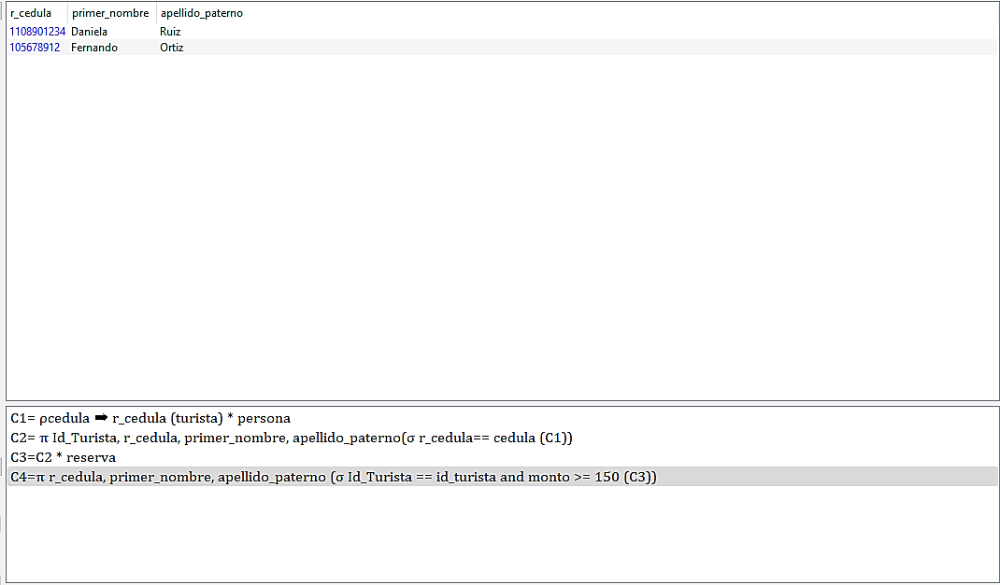
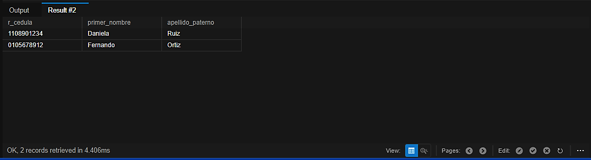
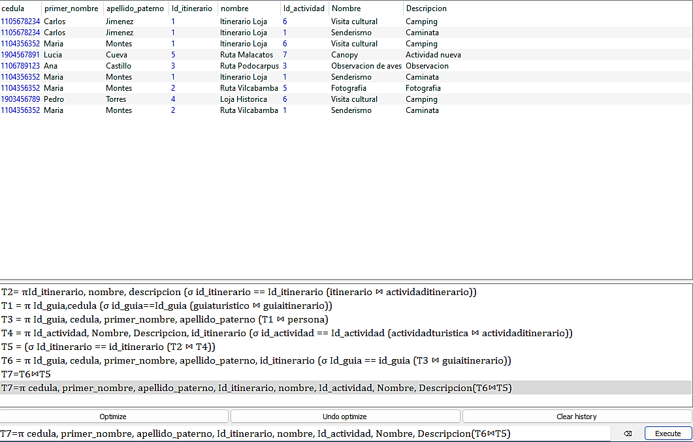
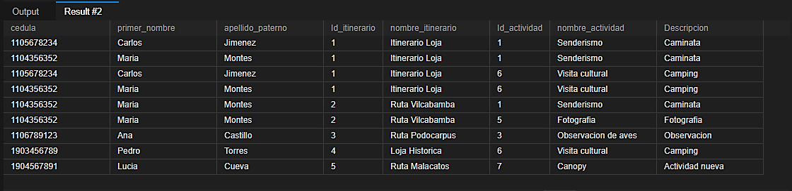
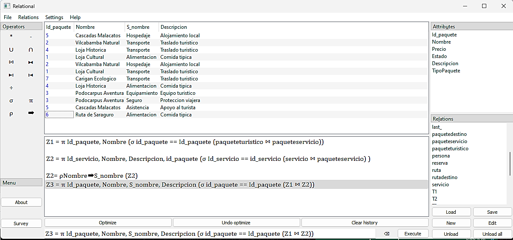
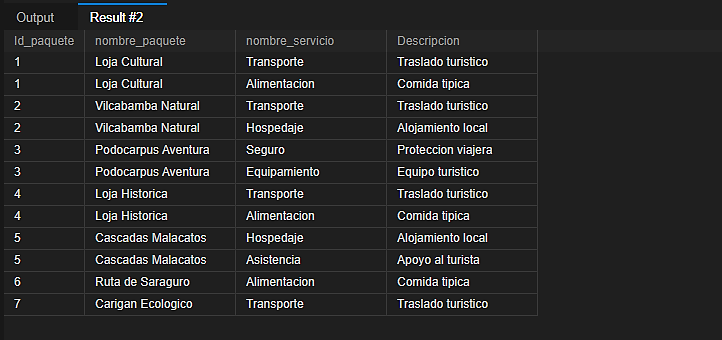
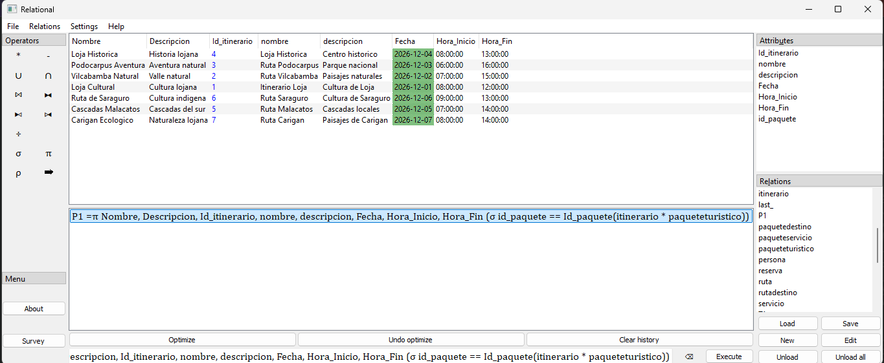
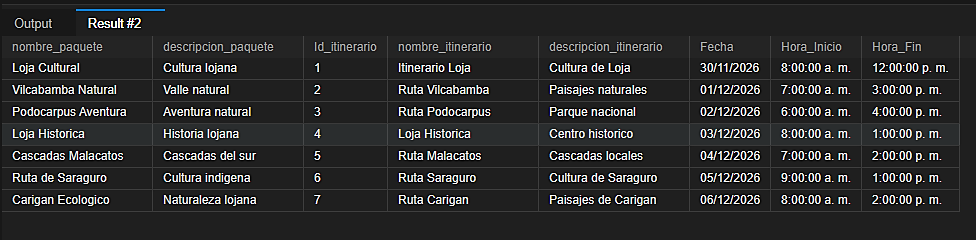
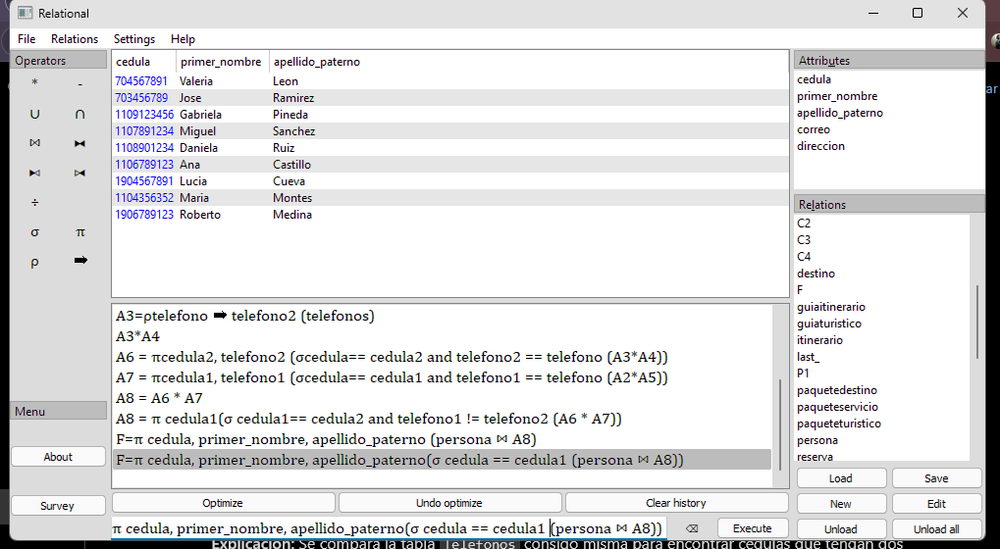
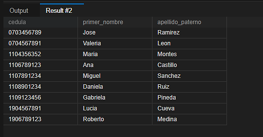

# 🧮 6. Consultas de álgebra relacional y su traducción a SQL

[](README.md) [](05-codigo-sql.md)

---

## 🧭 Consultas del proyecto

| N.º | Consulta | Acceso |
|:--:|:---|:---|
| 1 | Mostrar los turistas que tienen reservas mayores a 150$ | [](#-consulta-1) |
| 2 | Mostrar los guías que participan en itinerarios y sus actividades correspondientes | [](#-consulta-2) |
| 3 | Mostrar los servicios que ofrece cada paquete | [](#-consulta-3) |
| 4 | Mostrar toda la información de los itinerarios con el nombre de su respectivo paquete | [](#-consulta-4) |
| 5 | Mostrar la cédula, el nombre y el apellido de las personas que tienen más de un teléfono | [](#-consulta-5) |

---

## 🔎 Consulta 1

> **Mostrar los turistas que tienen reservas mayores a 150$**

### 📐 Álgebra relacional

```text
C1= ρcedula ➡ r_cedula (turista) * persona
C2= π Id_Turista, r_cedula, primer_nombre, apellido_paterno(σ r_cedula== cedula (C1))
C3=C2 * reserva
C4=π r_cedula, primer_nombre, apellido_paterno (σ Id_Turista == id_turista and monto >= 150 (C3))
```

<div align="center">



</div>

<p align="center"><em>Figura 4. Resultado de la consulta 1 mostrando los turistas que tienen reservas mayores a $150.</em></p>

### 💻 Consulta traducida a SQL

```sql
SELECT
    T.cedula AS r_cedula,
    P.primer_nombre,
    P.apellido_paterno
FROM turista T
INNER JOIN persona P
    ON T.cedula = P.cedula
INNER JOIN reserva R
    ON T.Id_Turista = R.id_turista
WHERE R.monto >= 150;
```

**✅ Resultado esperado:** Se obtendrán los registros de los turistas que hayan realizado reservas con un monto igual o superior a 150. La consulta mostrará el número de cédula, el primer nombre y el apellido paterno de cada turista que cumpla con esta condición.

<div align="center">



</div>

<p align="center"><em>Figura 5. Resultado de la consulta 1 ejecutada en SQL, mostrando la información de los turistas que cumplen con la condición establecida.</em></p>

---

## 🔎 Consulta 2

> **Mostrar los guías que participan en itinerarios y sus actividades correspondientes**

### 📐 Álgebra relacional

```text
T2= πId_itinerario, nombre, descripcion (σ id_itinerario == Id_itinerario (itinerario ⋈ actividaditinerario))
T1 = π Id_guia,cedula (σ id_guia==Id_guia (guiaturistico ⋈ guiaitinerario))
T3 = π Id_guia, cedula, primer_nombre, apellido_paterno (T1 ⋈ persona)
T4 = π Id_actividad, Nombre, Descripcion, id_itinerario (σ id_actividad == Id_actividad (actividadturistica ⋈ actividaditinerario))
T5 = (σ Id_itinerario == id_itinerario (T2 ⋈ T4))
T6 = π Id_guia, cedula, primer_nombre, apellido_paterno, id_itinerario (σ Id_guia == id_guia (T3 ⋈ guiaitinerario))
T7=T6⋈T5
T7=π cedula, primer_nombre, apellido_paterno, Id_itinerario, nombre, Id_actividad, Nombre, Descripcion(T6⋈T5)
```

<div align="center">



</div>

<p align="center"><em>Figura 6. Resultado de la consulta 2, identificando los guías turísticos que participan en itinerarios y sus actividades correspondientes.</em></p>

### 💻 Consulta traducida a SQL

```sql
SELECT
    GT.cedula,
    P.primer_nombre,
    P.apellido_paterno,
    I.Id_itinerario,
    I.nombre AS nombre_itinerario,
    A.Id_actividad,
    A.Nombre AS nombre_actividad,
    A.Descripcion
FROM itinerario I
INNER JOIN actividaditinerario AI
    ON I.Id_itinerario = AI.id_itinerario
INNER JOIN actividadturistica A
    ON AI.id_actividad = A.Id_actividad
INNER JOIN guiaitinerario GI
    ON I.Id_itinerario = GI.id_itinerario
INNER JOIN guiaturistico GT
    ON GI.Id_guia = GT.Id_guia
INNER JOIN persona P
    ON GT.cedula = P.cedula;
```

**✅ Resultado esperado:** Se obtendrán los registros de los guías turísticos que están asignados a los itinerarios, mostrando su número de cédula, primer nombre y apellido paterno. Además, se presentará el nombre y la descripción de cada actividad turística que forma parte de dichos itinerarios. De esta manera, se podrá identificar qué guía participa en cada itinerario y qué actividades se encuentran programadas.

<div align="center">



</div>

<p align="center"><em>Figura 7. Resultado de la consulta 2 ejecutada en SQL, mostrando los guías turísticos, los itinerarios y las actividades asignadas.</em></p>

---

## 🔎 Consulta 3

> **Mostrar los servicios que ofrece cada paquete**

### 📐 Álgebra relacional

```text
Z1 = π Id_paquete, Nombre (σ id_paquete == Id_paquete (paqueteturistico ⋈ paqueteservicio))
Z2 = π Id_servicio, Nombre, Descripcion, id_paquete (σ Id_servicio == id_servicio (servicio ⋈ paqueteservicio))
Z2= ρNombre➡S_nombre (Z2)
Z3 = π Id_paquete, Nombre, S_nombre, Descripcion (σ id_paquete == Id_paquete (Z1 ⋈ Z2))
```

<div align="center">



</div>

<p align="center"><em>Figura 8. Resultado de la consulta 3 mediante álgebra relacional, mostrando los paquetes turísticos junto con los servicios que ofrece cada uno.</em></p>

### 💻 Consulta traducida a SQL

```sql
SELECT
    PT.Id_paquete,
    PT.Nombre AS nombre_paquete,
    S.Nombre AS nombre_servicio,
    S.Descripcion
FROM paqueteturistico PT
INNER JOIN paqueteservicio PS
    ON PT.Id_paquete = PS.id_paquete
INNER JOIN servicio S
    ON PS.Id_servicio = S.Id_servicio;
```

**✅ Resultado esperado:** Se obtienen 12 registros que muestran los paquetes turísticos junto con los servicios que ofrece cada uno, incluyendo el identificador del paquete, nombre del paquete, nombre del servicio y descripción del servicio. Por ejemplo, Loja Cultural ofrece Transporte y Alimentación, mientras que Podocarpus Aventura ofrece Seguro y Equipamiento.

<div align="center">



</div>

<p align="center"><em>Figura 9. Resultado de la consulta 3 ejecutada en SQL, presentando los paquetes turísticos y sus respectivos servicios.</em></p>

---

## 🔎 Consulta 4

> **Mostrar toda la información de los itinerarios con el nombre de su respectivo paquete**

### 📐 Álgebra relacional

```text
P1 =π Nombre, Descripcion, Id_itinerario, nombre, descripcion, Fecha, Hora_Inicio, Hora_Fin (σ id_paquete = Id_paquete(itinerario * paqueteturistico))
```

<div align="center">



</div>

<p align="center"><em>Figura 10. Resultado de la consulta 4 mediante álgebra relacional, mostrando la información de los itinerarios junto con el nombre de su respectivo paquete turístico.</em></p>

### 💻 Consulta traducida a SQL

```sql
SELECT
    PT.Nombre AS nombre_paquete,
    PT.Descripcion AS descripcion_paquete,
    I.Id_itinerario,
    I.nombre AS nombre_itinerario,
    I.descripcion AS descripcion_itinerario,
    I.Fecha,
    I.Hora_Inicio,
    I.Hora_Fin
FROM itinerario I
INNER JOIN paqueteturistico PT
    ON I.id_paquete = PT.Id_paquete;
```

**✅ Resultado esperado:** Se obtendrán los registros de los itinerarios junto con el nombre del paquete turístico al que pertenece cada uno. Se mostrarán el identificador del itinerario, su nombre, descripción, fecha, hora de inicio, hora de finalización y nombre del paquete correspondiente. De esta manera, se podrá identificar qué paquete turístico está asociado a cada itinerario. Con los datos registrados, se esperan 7 resultados.

<div align="center">



</div>

<p align="center"><em>Figura 11. Resultado de la consulta 4 ejecutada en SQL, presentando los itinerarios y los datos de los paquetes turísticos asociados.</em></p>

---

## 🔎 Consulta 5

> **Mostrar la cédula, el nombre y el apellido de las personas que tienen más de un teléfono**

### 📐 Álgebra relacional

```text
A2=ρtelefono ➡ telefono1 (telefonos)
A3=ρtelefono ➡ telefono2 (telefonos)
A4=ρcedula ➡ cedula2 (telefonos)
A5=ρcedula ➡ cedula1 (telefonos)
A6 = πcedula2, telefono2 (σcedula== cedula2 and telefono2 == telefono (A3*A4))
A7 = πcedula1, telefono1 (σcedula== cedula1 and telefono1 == telefono (A2*A5))
A8 = π cedula1(σ cedula1== cedula2 and telefono1 != telefono2 (A6 * A7))
F=π cedula, primer_nombre, apellido_paterno(σ cedula == cedula1 (persona ⋈ A8))
```

<div align="center">



</div>

<p align="center"><em>Figura 12. Resultado de la consulta 5 mediante álgebra relacional, identificando las personas que tienen más de un número telefónico registrado.</em></p>

### 💻 Consulta traducida a SQL

```sql
SELECT
    P.cedula,
    P.primer_nombre,
    P.apellido_paterno
FROM persona P
INNER JOIN telefonos T1
    ON P.cedula = T1.cedula
INNER JOIN telefonos T2
    ON T1.cedula = T2.cedula
WHERE T1.telefono <> T2.telefono
GROUP BY
    P.cedula,
    P.primer_nombre,
    P.apellido_paterno;
```

**✅ Resultado esperado:** Se obtendrán los registros de las personas que tienen más de un teléfono registrado, mostrando su número de cédula, primer nombre y apellido paterno. Se identificarán aquellas personas que poseen al menos dos números telefónicos diferentes, evitando contar dos veces el mismo número. De esta manera, se podrá conocer qué personas tienen varios teléfonos registrados en el sistema.

<div align="center">



</div>

<p align="center"><em>Figura 13. Resultado de la consulta 5 ejecutada en SQL, mostrando la cédula, el primer nombre y el apellido paterno de las personas que tienen varios teléfonos registrados.</em></p>

---

<div align="center">

[](README.md) [](05-codigo-sql.md)

</div>
