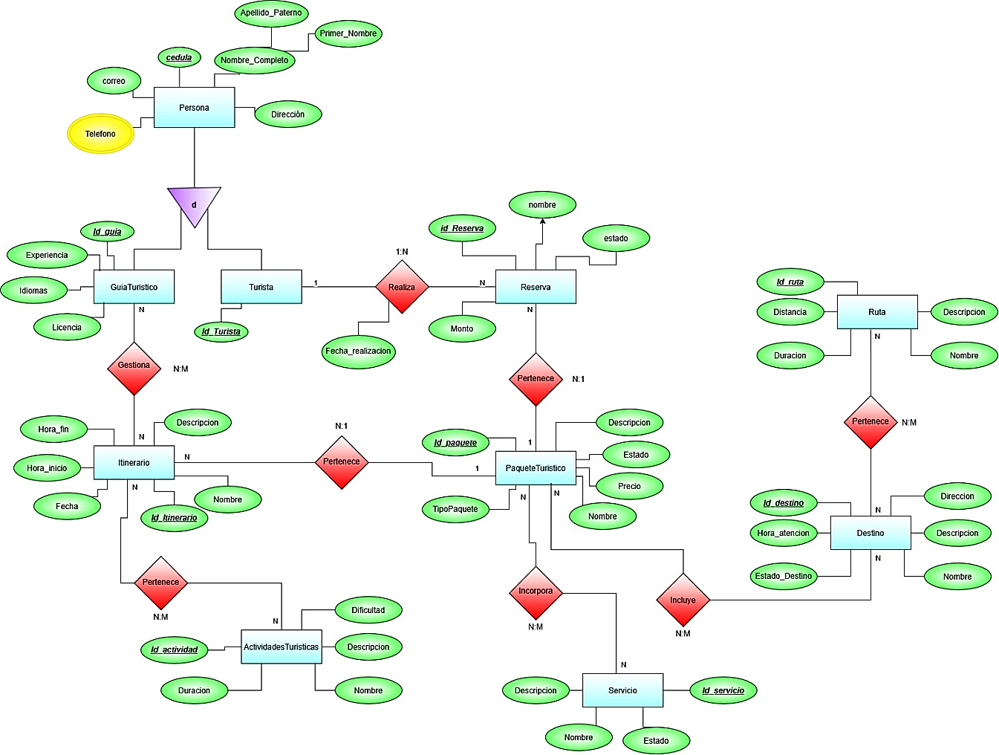
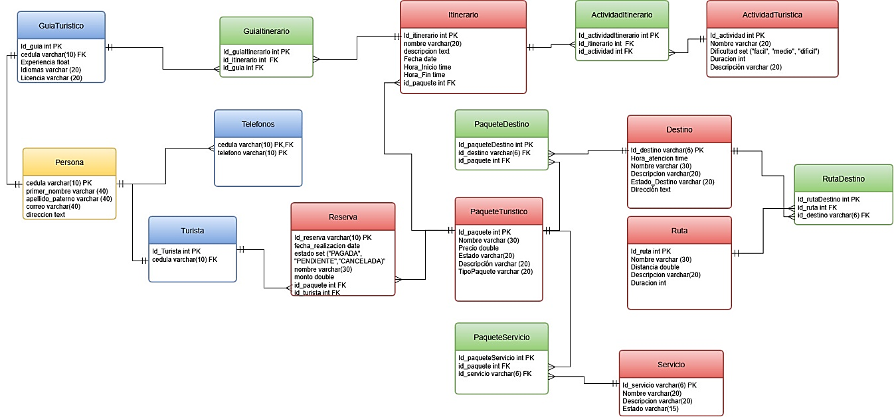

# 📦 Proyecto Unidad 1 — Informe de fin de unidad

 

**FEIRNNR — Carrera de Computación**

### INFORME DE FIN DE UNIDAD

---

## 📋 Datos generales

| 📋 Datos generales | Detalle |
|:---|:---|
| 📖 **Asignatura** | Base de datos |
| 🏫 **Ciclo** | 3 A |
| 🔢 **Unidad** | 1 |
| 🎯 **Resultado de aprendizaje de la unidad** | Modela bases de datos de problemas reales, bajo los principios de solidaridad, transparencia, responsabilidad y honestidad. |
| 👨‍🏫 **Nombre del docente** | Edwin René Guamán Quinche |
| 📅 **Fecha** | 12-11-2026 |
| 👨‍🎓 **Nombres y apellidos del estudiante** | Yimmy Onner Angulo Torres |

---

## 🧭 Contenido del informe

| N.º | Sección | Acceso |
|:--:|:---|:---|
| 1 | 🏷️ **Título** |  |
| 2 | 🧩 **Contexto del problema** |  |
| 3 | 🎯 **Objetivos** |  |
| 4 | 🔷 **Modelos conceptuales de bases de datos** |  |
| 5 | 💻 **Código SQL** (DDL y DML) |  |
| 6 | 🧮 **Consultas de álgebra relacional y SQL** |  |
| 7 | 🧠 **Conclusiones** |  |
| 8 | 📚 **Bibliografía** |  |

---

## 🏷️ 1. Título

> **Implementación de un sistema web para la Optimización y la Gestión de una Agencia de Turismo dentro de la ciudad de Loja**

---

## 🧩 2. Contexto del problema

Actualmente, dentro de la ciudad de Loja, los turistas experimentan algunas dificultades al momento de conocer y adquirir paquetes turísticos, debido a que no cuentan con un sistema que les permita consultar de manera rápida las diferentes opciones disponibles, sus precios y destinos. Además, el registro de las reservas y compras se realiza mediante hojas de Excel, lo que genera pérdida de tiempo y acumulación de información.

La agencia de turismo administra los itinerarios disponibles, los paquetes turísticos con sus respectivos precios, destinos y estados (disponible o no disponible), así como las compras y reservas realizadas por los turistas. Sin embargo, llevar todos estos registros en una hoja de Excel dificulta mantener la información organizada y realizar consultas o actualizaciones de manera rápida y eficiente.

Esta situación afecta principalmente a la agencia de turismo y a los turistas que utilizan sus servicios. Por una parte, la agencia presenta dificultades para mantener un control adecuado de los paquetes turísticos, destinos e itinerarios disponibles. Por otra parte, los turistas pueden experimentar demoras al consultar los paquetes, conocer sus precios y realizar una reserva.

Para mejorar esta situación, se necesita gestionar adecuadamente los datos de los clientes, destinos turísticos, paquetes turísticos, reservas, servicios, itinerarios, guías turísticos, rutas y actividades turísticas. Una correcta administración de esta información permitirá mantener los registros organizados, evitar la duplicación de datos, consultar la disponibilidad de los paquetes turísticos y llevar un mejor control de las reservas realizadas por los clientes.

De esta manera, el diseño e implementación de una base de datos representa una solución para organizar y facilitar la gestión de la información de la agencia de turismo, constituyendo una base para el desarrollo de un sistema web que permita mejorar los procesos de registro, búsqueda y consulta.

---

## 🎯 3. Objetivos

### 🔹 3.1. Objetivo general

Diseñar, elaborar e implementar un sistema web para facilitar el proceso de registro, búsqueda, y consulta dentro de las actividades de una agencia de turismo de la ciudad de Loja.

### 🔹 3.2. Objetivos específicos

- 🔷 Construir, diseñar y determinar el modelo base de nuestro sistema el cual es el Modelo Entidad-Relacion, para obtener una base real de la cual partir para elaborar el sistema.
- 🧮 Implementar el modelo relacional en donde se señale de manera detallada los valores únicos, las claves primarias, y las claves foráneas, además, de ejecutar un servidor de MySQL, en donde se desarrollará la base de datos de nuestro sistema, incluyendo las búsquedas de datos mediante algebra relacional y consultas SQL.

---

## 🔷 4. Modelos conceptuales de bases de datos

### 🗺️ 4.1. Modelo Entidad-Relación (E-R)

El modelo Entidad-Relación desarrollado representa la estructura de la base de datos para un sistema de gestión de una agencia de turismo de la ciudad de Loja. Su finalidad es organizar la información necesaria para administrar los clientes, guías turísticos, destinos, paquetes turísticos, reservas, servicios, itinerarios, rutas y actividades turísticas.

Mediante la identificación de entidades, atributos y relaciones, se estableció cómo se conectan los diferentes elementos del sistema, definiendo sus respectivas cardinalidades y claves primarias. También se consideró la relación de especialización entre Persona, Cliente y GuiaTuristico, permitiendo agrupar los datos personales comunes y diferenciarlos según la función que cumplen dentro del sistema.

Asimismo, se identificaron relaciones de uno a muchos y de muchos a muchos, estas últimas representadas mediante entidades asociativas para mantener una estructura organizada y evitar la duplicación de información. De esta manera, el modelo E-R constituye la representación conceptual que sirve como base para transformar los requerimientos del sistema en el modelo relacional y posteriormente implementarlos en MySQL.

<em>Figura 1. Diagrama Entidad-Relación del sistema (Sistema para una agencia de Turismo).</em>

### 🧮 4.2. Modelo Relacional

El modelo relacional representa la transformación del diagrama Entidad-Relación (E-R) en un conjunto de tablas que permiten organizar y almacenar la información del sistema de gestión de una agencia de turismo de la ciudad de Loja. En este modelo, cada entidad identificada se convierte en una tabla con sus respectivos atributos, tipos de datos y claves primarias, las cuales permiten identificar de manera única cada registro.

Además, se establecen las claves foráneas para representar las relaciones entre las tablas y mantener la integridad de la información. En los casos donde existen relaciones de muchos a muchos (M:N), se utilizan tablas asociativas que permiten conectar las entidades involucradas sin generar duplicación innecesaria de datos.

De esta manera, el modelo relacional constituye la estructura lógica de la base de datos y sirve como guía para su implementación en MySQL, facilitando el almacenamiento, la búsqueda, la actualización y la consulta de la información.

<em>Figura 2. Diagrama Modelo Relacional del sistema mediante tablas (Sistema para una agencia de Turismo).</em>

---

## 💻 5. Código SQL

 — creación de tablas (DDL) e inserción de datos (DML).

## 🧮 6. Consultas de álgebra relacional y SQL

 — 5 consultas con su expresión en álgebra relacional y su traducción a SQL.

---

## 🧠 7. Conclusiones

1. La elaboración del diagrama Entidad-Relación permitió comprender la importancia de identificar correctamente las entidades, atributos y relaciones que intervienen en el funcionamiento de una agencia de turismo de la ciudad de Loja. Durante este proceso se presentaron dificultades al determinar las relaciones y cardinalidades entre algunas entidades, especialmente al establecer cuándo correspondía utilizar relaciones de uno a muchos o de muchos a muchos. Sin embargo, este trabajo permitió organizar la información de manera lógica y representar las necesidades del sistema, obteniendo un modelo conceptual y relacional que sirve como base para el desarrollo de la base de datos.

2. La implementación de la base de datos en MySQL permitió llevar el diseño realizado a una estructura funcional, comprendiendo cómo se organizan y relacionan los datos dentro de un sistema relacional. Mediante el lenguaje SQL se aplicaron instrucciones DDL para crear las tablas, definir sus atributos y establecer las claves primarias y foráneas; además, se utilizaron instrucciones DML para insertar, modificar y administrar los registros. Esta experiencia permitió reconocer la importancia de las restricciones de integridad y de una correcta definición de las relaciones, ya que contribuyen a mantener la información organizada, consistente y sin duplicaciones innecesarias.

3. El estudio y la aplicación del álgebra relacional permitieron comprender la lógica que existe detrás de la recuperación de información en una base de datos, facilitando la construcción de consultas SQL de acuerdo con las necesidades del sistema. Operaciones como la selección, proyección y combinación de tablas resultaron especialmente útiles para filtrar información, obtener datos específicos y relacionar registros de clientes, reservas, paquetes turísticos y destinos. De esta manera, se comprendió que el álgebra relacional constituye una base fundamental para desarrollar consultas SQL que faciliten los procesos de búsqueda y consulta de información de la agencia de turismo.

4. El desarrollo de esta actividad permitió establecer las bases para el diseño e implementación de un sistema web orientado a facilitar el registro, búsqueda y consulta de información de una agencia de turismo de la ciudad de Loja. A través del modelado, la construcción de la base de datos en MySQL y la elaboración de consultas, se logró comprender cómo una adecuada organización de los datos contribuye a mejorar la gestión de la información. En conjunto, los conocimientos adquiridos representan un punto de partida para continuar con el desarrollo del sistema y responder a las necesidades identificadas en el proyecto.

---

## 📚 8. Bibliografía

[1] E. Gutiérrez et al., “Preserving Long-Term Access to Decommissioned Database Systems With Immortal Database Access (iDA),” *IEEE Access*, vol. 14, pp. 24496–24511, 2026. doi: [https://doi.org/10.1109/ACCESS.2026.3664594](https://doi.org/10.1109/ACCESS.2026.3664594).

[2] G. Carvalho, J. Bernardino, V. Pereira, and B. Cabral, “ER+: A Conceptual Model for Distributed Multilayer Systems,” *IEEE Access*, vol. 11, pp. 62744–62757, 2023. doi: [https://doi.org/10.1109/ACCESS.2023.3287796](https://doi.org/10.1109/ACCESS.2023.3287796).

[3] T. W. Ling and M. L. Lee, “Entity-Relationship Model,” in *Wiley Encyclopedia of Computer Science and Engineering*, B. W. Wah, Ed. Wiley, 2008. doi: [https://doi.org/10.1002/9780470050118.ecse501](https://doi.org/10.1002/9780470050118.ecse501).

[4] G. Carvalho, J. Bernardino, B. Cabral, and V. Pereira, “A Survey of Holistic Approaches for Distributed Database Systems: From Conceptual Model to Deployment,” *IEEE Access*, vol. 13, pp. 120830–120851, 2025. doi: [https://doi.org/10.1109/ACCESS.2025.3587670](https://doi.org/10.1109/ACCESS.2025.3587670).

---

  

